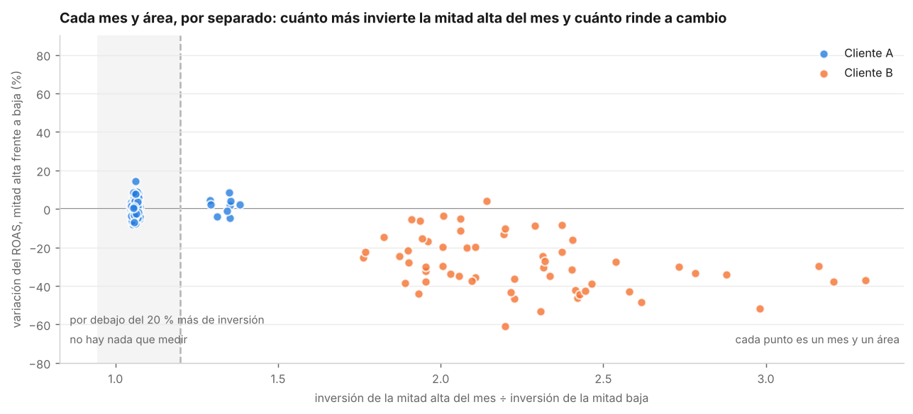
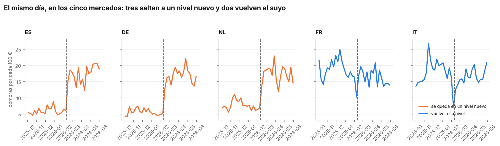

# Saturación de inversión en dos cuentas de Meta Ads

**Si esta cuenta recibe un euro más, ¿rinde igual que el anterior?** Es la pregunta que decide un
presupuesto. El método habitual para responderla —partir los días en cuartiles de inversión y mirar
cómo cae el ROAS— da el resultado **contrario al verdadero** en una de las dos cuentas de este
proyecto.

Este repositorio contiene el pipeline que une dos exportaciones con formatos distintos, las consultas
SQL del análisis y un notebook que recorre el camino entero: el análisis que sale mal, por qué sale
mal, y la corrección.

**→ [`notebooks/01_analisis.ipynb`](notebooks/01_analisis.ipynb) — el análisis completo, con los
resultados ya ejecutados. Si solo vas a ver una cosa, que sea esa.**

> **Sobre los datos.** El análisis original se hizo sobre dos cuentas de clientes reales y esos datos
> no se pueden publicar. Lo que hay en este repositorio lo genera
> [`src/generar_datos.py`](src/generar_datos.py), calibrado para reproducir la estructura que el
> análisis tiene que detectar: presupuesto mensual en una cuenta y diario en la otra, saturación real
> en una sola de ellas, una ruptura de medición y pausas de cuenta con ingresos residuales. Clientes,
> mercados y fechas son inventados. **Las cifras de este README son las que produce el notebook sobre
> esos datos, y cualquiera puede reproducirlas en tres comandos.**

---

## El hallazgo principal



Cada punto es un mes y un área. El eje horizontal dice cuánto más invirtió la mitad alta del mes que
la baja; el vertical, cuánto rindió a cambio.

| | Cliente A | Cliente B |
|---|---|---|
| Meses medibles | 9 (3 por área) | 58 |
| Meses en que la mitad alta rinde menos | 3 de 9 | **57 de 58** |
| Variación mediana del ROAS | +1,8 % a +4,1 % | **−26 % a −38 %** |
| Cuánto más invierte la mitad alta | ×1,3 | ×2,1 |

**El Cliente B tiene rendimientos decrecientes y en el Cliente A no se detectan.** Con cuartiles
sobre el periodo completo, los dos habrían parecido lo mismo —o justo al revés.

---

## Los cinco hallazgos

**1. Un cuartil de inversión puede ser un mes disfrazado.**
El presupuesto del Cliente A se fija una vez al mes, así que ordenar los días por inversión es
ordenar los meses: enero cae entero en el cuartil 1 y noviembre entero en el cuartil 4. Como el
presupuesto sube en los meses de más demanda, el análisis por cuartiles concluye que *cuanto más
invierte, mejor rinde*. Es causalidad inversa: no es que invertir más suba el ROAS, es que cuando el
ROAS va a ser alto se invierte más.
→ *Antes de leer un cuartil, cruzarlo con el mes. Si cada cuartil es casi un mes entero, la
saturación se mide dentro del mes.*

**2. La forma de gestionar cada cuenta decide cuánto se puede medir en ella.**
Al Cliente A le quedan 3 meses medibles por área y al B más de veinte, porque el B mueve el
presupuesto al doble de un día a otro y el A no lo mueve. Así que lo que se puede afirmar del Cliente
A es **que no se detectan rendimientos decrecientes, no que no existan**: ausencia de evidencia, no
evidencia de ausencia.
→ *La fuerza de la evidencia forma parte del resultado y se escribe junto a él.*

**3. Promediar ratios da una cifra creíble y falsa.**
`AVG(roas)` se desvía un 10 % de media, y en el mes de una pausa larga da **22,5 cuando el ROAS real
es 11,0**: un 105 % de error. Lo producen unos pocos días con menos de 20 € de inversión y un ROAS de
tres cifras, que en una media pesan lo mismo que un martes normal de 2.000 €. No falla nada: solo
sale un número razonable y equivocado.
→ *Un ratio agregado se calcula sumando numerador, sumando denominador y dividiendo al final. Por eso
las métricas derivadas viven en [una sola vista](sql/vista_metricas.sql).*

**4. Un salto de ROAS que no es una mejora.**
El ROAS del Cliente B se multiplica por tres a principios de 2026 con la inversión plana. Separando
el ROAS en sus dos factores, el salto está **en el número de compras contadas** y el valor medio por
compra no se mueve (~52 € antes y después). Y ocurre **el mismo día en los cinco mercados**. Ninguna
acción comercial hace eso: es un cambio de medición.
→ *Queda fechado y acotado, no explicado. No se comparan ROAS a los dos lados de esa fecha, y ningún
periodo del análisis la cruza.*



**5. El ROAS medio no dice dónde poner el euro siguiente.**
El área con mejor ROAS medio del Cliente B **no** es la que mejor absorbe el euro extra: el orden
cambia según cuál de las dos preguntas se responda. Un reparto de presupuesto hecho con el ROAS medio
apuntaría al área equivocada.
→ *Para decidir presupuesto manda el ROAS marginal. Con la salvedad de que un marginal alto no
significa rentable: el margen de producto no está en estos datos.*

---

## Cómo ejecutarlo

```bash
pip install -r requirements.txt
python -m src.pipeline          # genera los datos, los unifica y crea la base SQLite
jupyter notebook notebooks/01_analisis.ipynb
```

El pipeline es repetible: borrar `data/` y volver a ejecutarlo da exactamente lo mismo.

```
Pipeline
------------------------------------------------------------------------
  Cliente A      2,736 filas   2024-01-01 a 2026-06-30   areas: Kids, Men, Women
  Cliente B     18,242 filas   2024-04-01 a 2026-06-30   areas: Kids, Men, Women
  descartadas      547 filas del Cliente B sin area reconocible (campanas de marca)
  unificado     20,978 filas
------------------------------------------------------------------------
  tabla campanas: 20,978 filas
  vista v_metricas_diarias: 11,862 filas
  cuadre de inversion tabla/vista: 4,940,179.46 / 4,940,179.46  -> OK
```

---

## Qué hay en el repositorio

```
src/
  generar_datos.py   genera las dos exportaciones sintéticas, con sus anomalías
  limpieza.py        lleva dos formatos distintos a un esquema común
  base_datos.py      carga en SQLite y ejecuta los .sql
  pipeline.py        orquesta todo y cuadra los totales al terminar
sql/
  vista_metricas.sql          la vista: una sola definición de cada métrica derivada
  analisis/                   ocho consultas, una por archivo
notebooks/
  01_analisis.ipynb           el análisis, ejecutado
docs/
  metodo.md                   las decisiones de método, con su porqué
informes/                     las figuras que genera el notebook
```

Las dos exportaciones de partida **no tienen el mismo formato**, que es el problema real de
cualquier proyecto con dos fuentes: una trae el área en una columna propia y la otra la lleva dentro
del nombre del conjunto de anuncios, de donde hay que extraerla. Esa extracción tiene dos trampas que
`limpieza.py` documenta: *men* está dentro de *women*, y el límite de palabra `\b` no sirve porque
los nombres separan con guiones bajos y acaban en números.

### Las consultas

| Archivo | Qué responde |
|---|---|
| [`00_cuadre_totales.sql`](sql/analisis/00_cuadre_totales.sql) | ¿La vista ha perdido o duplicado algo? |
| [`01_calidad_datos.sql`](sql/analisis/01_calidad_datos.sql) | ¿Qué rarezas hay y **cuánto pesan sobre los ingresos**? |
| [`10_roas_por_cliente_y_area.sql`](sql/analisis/10_roas_por_cliente_y_area.sql) | ¿Cuánto pesa y cuánto rinde cada área? |
| [`20_estacionalidad_e_interanual.sql`](sql/analisis/20_estacionalidad_e_interanual.sql) | ¿Cómo va cada mes contra el mismo mes del año anterior? |
| [`30_cuartiles_sobre_el_periodo.sql`](sql/analisis/30_cuartiles_sobre_el_periodo.sql) | Saturación, primer intento — **el que sale mal** |
| [`31_saturacion_dentro_del_mes.sql`](sql/analisis/31_saturacion_dentro_del_mes.sql) | Saturación, el que vale |
| [`40_ruptura_de_serie.sql`](sql/analisis/40_ruptura_de_serie.sql) | ¿Mejoró la cuenta o cambió la forma de contar? |
| [`50_comparativa_clientes_por_area.sql`](sql/analisis/50_comparativa_clientes_por_area.sql) | Los dos clientes, uno al lado del otro |

Las consultas 30 y 31 están las dos en el repositorio a propósito: la primera está bien escrita,
devuelve una tabla creíble y su conclusión es falsa. La diferencia entre las dos es el proyecto
entero.

---

## Limitaciones

- **Los datos son sintéticos.** Reproducen la estructura del problema, no las cifras de ninguna
  cuenta real.
- **Atribución diaria.** Los días de poca inversión reciben compras atribuidas a clics de días
  anteriores, lo que infla su ROAS. Empuja en la misma dirección que el hallazgo de saturación, así
  que parte de la caída medida puede venir de ahí. El notebook comprueba que el resultado no depende
  de esos días, pero con datos diarios no se puede separar del todo.
- **Rango de inversión observado.** Nada de esto dice qué pasaría fuera de los niveles de inversión
  que hay en los datos.
- **Falta el margen de producto**, así que ningún ROAS se puede traducir en beneficio.
- **La causa de la ruptura de serie no está confirmada**, solo fechada y acotada. Confirmarla es una
  conversación con quien gestiona la cuenta, no otra consulta.
- Las pausas y las filas con compras sin impresiones **se conservan** en la base de datos y se
  excluyen solo en los cálculos donde distorsionan. Un dato raro documentado vale más que un dato
  raro desaparecido.

## Stack

Python (pandas, numpy, matplotlib) · SQLite · Jupyter · Git

Sin dependencias de pago ni servicios externos: `python -m src.pipeline` y funciona.
